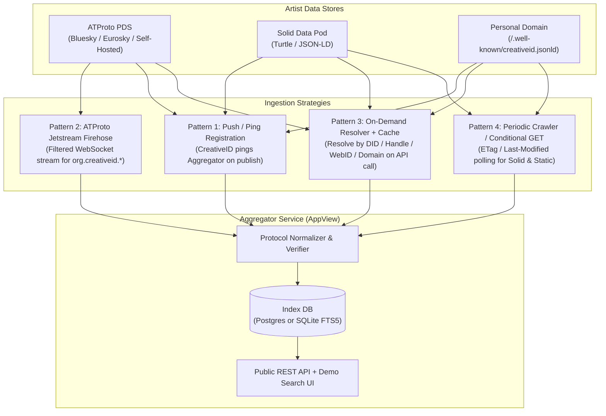

# CreativeID Aggregator & API Service — Architecture & Cost Analysis

## 1. The Core Architectural Challenge
When artists self-host or publish their CreativeID to different decentralized stores (**AT Protocol PDS**, **Solid Pods**, or **Static Domains**), a third-party service (e.g., a festival lineup site, music platform, or arts directory) cannot easily:
1. Know which protocol an artist used.
2. Perform full-text search across thousands of scattered Pods and PDSs in real time.
3. Parse three different wire formats (`org.creativepassport.actor.persona` XRPC JSON, RDF Turtle, and JSON-LD) on every request.

To solve this, you build an **Aggregator / Indexer Service** (called an **AppView** in AT Protocol terminology). It **discovers or ingests** records from all supported protocols, **normalizes** them back into the canonical CreativeID schema, **indexes** them in a fast local database (SQLite/FTS5 or Postgres), and exposes a **unified low-latency API + demo search UI**.

---

## 2. Four Ingestion & Discovery Patterns (Compared)

Because AT Protocol has a global real-time firehose while Solid and Static URLs are pull-based HTTP resources, there are four primary patterns for how your Aggregator gets artist data:



---

### Pattern 1: "WebSub / Ping-on-Publish" (Push Registration)
When the artist clicks **Publish** in their local CreativeID app, the local app (optionally) sends a lightweight notification to the Aggregator:
```json
POST https://api.creativeid.org/v1/notify
{
  "sourceType": "atproto" | "solid" | "static",
  "uri": "at://did:plc:.../org.creativepassport.actor.persona/self"
}
```
The Aggregator immediately fetches the record directly from the artist's PDS, Solid Pod, or domain, verifies it, and indexes it.

- **Works with**: ATProto, Solid Pods, Static URLs (100% uniform).
- **Pros**: Near-zero idle compute/bandwidth cost; instant indexing when an artist updates their bio; the only way to automatically discover brand-new Solid Pods or static domains without a central registry.
- **Cons**: Requires the artist's client (or a registration form) to ping the aggregator at least once.

---

### Pattern 2: AT Protocol Firehose via **Jetstream** (Passive Network-Wide Discovery)
In AT Protocol, every public write to any federated PDS (Bluesky, Eurosky, or self-hosted) is broadcast to Relays.
- **Full Relay Firehose (`com.atproto.sync.subscribeRepos`)**: Streams *all* network events (~500–2,000+ events/sec, CBOR/CAR binary blocks). High bandwidth and CPU cost to filter if you only care about `org.creativepassport.actor.persona`.
- **Jetstream (Recommended)**: Bluesky and community operators provide **Jetstream** instances—a lightweight WebSocket service where you pass a query filter:
  `wss://jetstream2.us-east.bsky.network/subscribe?wantedCollections=org.creativepassport.actor.persona`
  Jetstream sends you **only** JSON events matching your Lexicon collection!

- **Works with**: AT Protocol PDS (network-wide, zero artist registration required).
- **Pros**: Automatically discovers every artist who publishes an `org.creativepassport.actor.persona` record anywhere on ATProto, even if they didn't ping your server. Bandwidth is tiny (only matching records).
- **Cons**: Does not cover Solid Pods or Static URLs.

---

### Pattern 3: On-Demand Read-Through Resolver (Zero-Index / Lazy Caching)
A client calls your API with an artist identifier:
- `GET /v1/artists/did:plc:12345`
- `GET /v1/artists/ada.bsky.social`
- `GET /v1/artists?uri=https://ada.solidcommunity.net/public/creativeid.ttl`
- `GET /v1/artists/ada.example.com` (checks DNS TXT `_creativeid.ada.example.com` or `https://ada.example.com/.well-known/creativeid.jsonld`)

If the artist is not in cache (or TTL expired), the Aggregator resolves their store on the fly, normalizes the response, caches it with a TTL, and returns the unified JSON.

- **Works with**: ATProto, Solid, Static (`/.well-known/`).
- **Pros**: Lowest storage cost; always fresh; works immediately for any valid identifier.
- **Cons**: Cannot do full-text search (e.g., `GET /v1/search?q=ambient+modular+synth`) until an artist has been resolved or registered at least once.

---

### Pattern 4: Scheduled Conditional Polling (For Solid & Static Stores)
Because Solid Pods and Static web servers do not broadcast to a global firehose like ATProto, once a Solid or Static URI is known (via Pattern 1 or 3), a background worker periodically checks for updates using HTTP `ETag` and `If-Modified-Since` headers.
- Optionally, for Solid Pods that support **Solid Notifications Protocol** (WebSocket / Webhook), the aggregator can subscribe to changes on the resource URL.

---

## 3. Recommended Hybrid Architecture

The sweet spot—maximizing decentralization while keeping infrastructure costs under **$5–$20/month**—combines all four patterns into a single lightweight Node.js/TypeScript service:

### How It Works Together:
1. **Discovery**:
   - **ATProto**: A background **Jetstream WebSocket listener** (`wantedCollections=org.creativepassport.actor.persona`) automatically indexes every ATProto artist in real time.
   - **Solid & Static (and instant ATProto)**: A `POST /v1/index` (Ping) endpoint that the local CreativeID tool automatically calls right after publishing to a Solid Pod or Static URL.
   - **On-Demand Lookup**: If someone requests `GET /v1/artists/:identifier` for an unindexed DID, handle, WebID, or domain, the API resolves it live and adds it to the index.
2. **Verification & Normalization**:
   - **ATProto**: Resolves the DID via `plc.directory` or `did:web`, verifies the PDS endpoint, and fetches `org.creativepassport.actor.persona/self`.
   - **Solid / Static**: Fetches the Turtle or JSON-LD document (enforcing strict timeouts and max payload size, e.g., 64 KB, for SSRF/DoS protection) and parses `schema:name` + `schema:description`.
3. **Storage & Search Engine**:
   - Stores normalized artist records in **SQLite with FTS5** (Full-Text Search) or **PostgreSQL (`tsvector` + `pg_trgm`)**.
4. **Public API Surface**:
   - `GET /v1/artists?q=<search>&protocol=<atproto|solid|static>&limit=20` — Full-text search across names and biographies.
   - `GET /v1/artists/:id` — Fetch normalized CreativeID by Aggregator ID, DID (`did:plc:...`), Handle (`alice.bsky.social`), WebID, or Domain.
   - `POST /v1/index` — Submit/refresh an artist's URI (Ping-on-publish or manual registration).
   - `GET /` — Lightweight Demo Search & API Explorer UI.

---

## 4. Architecture Options & Cost Implications

Here are the three realistic deployment tiers depending on scale and operational preference:

### Option A: Single-Node VPS + SQLite FTS5 ("Indie / Public Good Tier") — **Recommended for v1**
- **Stack**: Node.js (Fastify or Hono + TypeScript), SQLite in WAL mode with **FTS5** full-text search, persistent Jetstream WebSocket consumer, and hourly `ETag` refresher for Solid/Static URLs.
- **Hosting**: Hetzner Cloud (`CX22`: 2 vCPU, 4 GB RAM, 40 GB NVMe) or Fly.io / DigitalOcean.
- **Capacity**: Easily handles **100,000+ artist profiles** and **500+ API requests/sec** (SQLite reads from local NVMe take microseconds).
- **Monthly Cost**: **~$4.50 – $7 / month** flat.
- **Why it wins for v1**: A Jetstream WebSocket connection requires a long-running process (which serverless functions charge extra for or struggle to maintain), and SQLite FTS5 gives you instant full-text search with zero managed database bills.

### Option B: Serverless Edge (Cloudflare Workers + D1 + Queues)
- **Stack**: Cloudflare Workers (API + On-demand resolver), Cloudflare D1 (serverless SQLite), Cloudflare Cron Triggers (polling), plus a tiny Worker/Durable Object for Jetstream.
- **Capacity**: Global edge caching; scales to millions of cached read requests.
- **Monthly Cost**: **$0 – $5 / month** at low volume; **$25 – $100+ / month** at high write/crawl volume.
- **Trade-offs**: Maintaining a persistent ATProto Jetstream WebSocket requires a Durable Object or external micro-worker; stricter CPU time limits when parsing RDF/JSON-LD payloads.

### Option C: Managed Cloud Scale (Managed Postgres + Containers + Redis)
- **Stack**: AWS ECS / Railway / Render + Managed PostgreSQL + Redis cache + dedicated crawler workers.
- **Capacity**: Millions of artists, multi-region failover, complex graph queries.
- **Monthly Cost**: **$50 – $200+ / month** (dominated by managed Postgres and multi-container base costs).
- **Trade-offs**: Overkill until multiple commercial platforms depend on your SLA.

---

## 5. Cost & Trade-Off Comparison Matrix

| Component | Low-Cost Choice (Recommended) | High-Cost Pitfall to Avoid |
| :--- | :--- | :--- |
| **ATProto Ingestion** | **Jetstream** filtered by `wantedCollections=org.creativepassport.actor.persona` (**$0 bandwidth**, <10 MB RAM) | Consuming the raw un-filtered Relay Firehose (`subscribeRepos`) (~1.5 TB/month ingress bandwidth + high CPU decoding CAR files) |
| **Solid / Static Ingestion** | **Ping-on-Publish** (`POST /v1/index`) + **Conditional GET** (`ETag` / `304 Not Modified`) | Blindly re-downloading full RDF files every 5 minutes without `ETag` or backoff |
| **Search Database** | **SQLite + FTS5** on local NVMe (or single Postgres instance) | Managed Elasticsearch / OpenSearch cluster ($100+/mo minimum) |
| **Static Artist Hosting** | Standardize `https://<artist-domain>/.well-known/creativeid.jsonld` | Requiring artists to configure custom CORS/headers on arbitrary paths |

---

## 6. How CreativeID Local Studio Connects to the Aggregator
If we build this Aggregator service next (either as a companion repo or a module inside this workspace), we can add an optional **"Ping Aggregator Directory on Publish"** toggle in CreativeID:
1. Artist saves their bio locally and publishes to **ATProto**, **Solid**, or **Static**.
2. CreativeID sends a 1-line `POST /v1/index` with the published URI to the Aggregator.
3. The Aggregator verifies the remote record directly from the artist's store and makes the artist immediately searchable via the Aggregator API and Demo Search UI.
