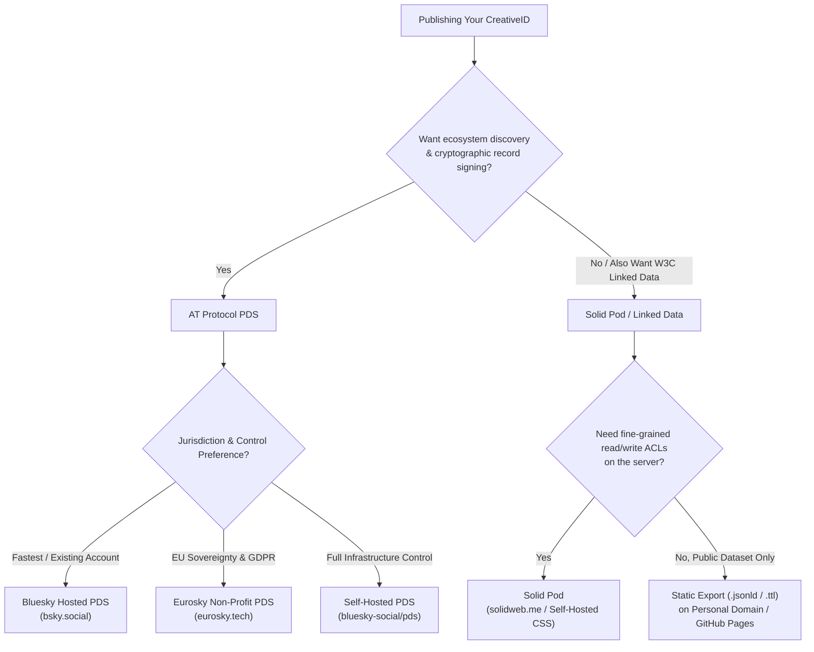

# Briefing: AT Protocol PDS & Solid Data Stores for CreativeID

This briefing explains how **AT Protocol Personal Data Servers (PDS)** and **Solid Data Pods** work as publishing targets for **CreativeID**, compares managed providers (**Bluesky**, **Eurosky**, community Solid Pod providers) against **self-hosting**, and provides step-by-step setup instructions.

---

## 1. Executive Summary: AT Protocol PDS vs. Solid Pods

Both protocols decouple **your identity and data** from **single-vendor applications**, but they approach data modeling and discovery differently:

| Dimension | AT Protocol (PDS) | Solid (Data Pod) |
| :--- | :--- | :--- |
| **Core Metaphor** | **Signed Git Repository of JSON Records** (Merkle Search Tree) | **Personal Web Server of Linked Data Documents** (RDF / REST) |
| **Identity Anchor** | **DID** (`did:plc:...` or `did:web:...`) + DNS Handle (`@ada.example.com`) | **WebID** (`https://pod.example/profile/card#me`) |
| **Data Schema** | **Lexicons** (strictly typed JSON schemas identified by reverse-DNS NSIDs like `org.creativepassport.actor.persona`) | **RDF Vocabularies / Ontologies** (`schema.org`, `foaf`, `vcard`, custom namespaces serialized as Turtle or JSON-LD) |
| **Access Control** | **Public by default** (repositories are public signed trees broadcast over the relay firehose; private data is evolving) | **Fine-grained Read/Write ACLs** (Web Access Control / ACP per container or file: public, specific WebIDs, or private) |
| **Strengths for CreativeID** | Instant discoverability across "The Atmosphere" (Bluesky & ATProto apps), cryptographic signing of every record (`cid`), zero-config custom Lexicon writes. | True Linked Data (`JSON-LD` / `Turtle`), granular privacy controls, standard HTTP `PUT`/`GET` semantics. |

---

## 2. AT Protocol Personal Data Servers (PDS)

### How a PDS Works
In the AT Protocol ("The Atmosphere"), every user account lives inside a **Personal Data Server (PDS)**.
- Your PDS holds your cryptographic signing key and hosts your personal data repository.
- Inside your repository, records are organized into **collections** named using reverse-DNS **Lexicon NSIDs**.
- Even if you signed up through Bluesky, your PDS is **not** limited to microblogging (`app.bsky.*`). Any application—including **CreativeID**—can write custom Lexicon records (such as `org.creativepassport.actor.persona` with record key `self`) into your repository using XRPC (`com.atproto.repo.putRecord`).

---

### Option A: Using Bluesky's Hosted PDS (Fastest Setup)
When you create a standard Bluesky account (`*.bsky.social`), Bluesky PBC hosts a PDS for you in the US (`https://bsky.social`, which routes to regional Mushroom PDS instances).

#### How to Set It Up with CreativeID:
1. Create or log into your account at `https://bsky.app`.
2. Go to **Settings → Privacy and Security → App Passwords**.
3. Click **Add App Password**, name it `CreativeID Studio`, and copy the generated `xxxx-xxxx-xxxx-xxxx` password. *(Never use your master account password in third-party tools).*
4. In CreativeID's **AT Protocol PDS** card:
   - **PDS Server URL**: `https://bsky.social`
   - **Handle or DID**: Your handle (e.g., `yourname.bsky.social` or custom domain handle)
   - **App Password**: Paste the App Password
5. Click **Publish to ATProto PDS**.
6. **Verify**: Your record is now live and publicly queryable at:
   ```
   https://bsky.social/xrpc/com.atproto.repo.getRecord?repo=<YOUR_DID_OR_HANDLE>&collection=org.creativepassport.actor.persona&rkey=self
   ```

---

### Option B: Using Eurosky (European Sovereign Non-Profit PDS)
**Eurosky** (`eurosky.tech`, an initiative under the Modal Foundation recognized as a Digital Public Good) provides independent, public-interest AT Protocol PDS hosting inside the **European Union** (hosted on European infrastructure in Germany under GDPR).

#### Why Choose Eurosky over Default Bluesky Hosting?
- **EU Data Sovereignty & GDPR**: Your repository data lives on European servers governed by EU privacy law rather than US commercial infrastructure.
- **Full Interoperability**: A Eurosky PDS account still works seamlessly with the Bluesky app and all other ATProto apps, because ATProto relays federate across PDS providers.
- **Account Portability (`did:plc`)**: If you already have a Bluesky account, you can migrate your existing DID, social graph, followers, and records to Eurosky (using migration tools such as *EU-HAUL* or *PDSMOOver*) without losing your identity.

#### How to Set It Up with CreativeID:
1. Create an account on Eurosky (or migrate an existing ATProto account to your Eurosky PDS).
2. Generate an **App Password** from your account settings.
3. In CreativeID's **AT Protocol PDS** card:
   - **PDS Server URL**: Enter your Eurosky PDS URL (e.g., `https://eurosky.social` or the specific PDS hostname assigned to your account—you can always inspect your DID document on `https://plc.directory/<your-did>` to see your exact `AtprotoPersonalDataServer` service endpoint).
   - **Handle or DID**: Your Eurosky handle or `did:plc:...`
   - **App Password**: Your App Password.

---

### Option C: Self-Hosting Your Own AT Protocol PDS
For complete autonomy, you can run your own single-user or small-community PDS on a cheap VPS (e.g., Hetzner, DigitalOcean, Fly.io).

#### Requirements:
- A Linux VPS (Ubuntu 22.04/24.04, 1 vCPU, 1–2 GB RAM, 20+ GB SSD)
- A domain name (e.g., `pds.yourdomain.com`) with wildcard DNS (`*.pds.yourdomain.com`) pointing to your server's IP for automatic TLS via Caddy.

#### Setup Steps (Official Bluesky Reference PDS):
1. Point `A` records for `pds.yourdomain.com` and `*.pds.yourdomain.com` to your VPS IP.
2. SSH into your server and run the official PDS installer:
   ```bash
   wget https://raw.githubusercontent.com/bluesky-social/pds/main/installer.sh
   sudo bash installer.sh
   ```
   *(This installs Docker, Caddy for automatic HTTPS, SQLite repository storage, and the `pdsadmin` CLI).*
3. Create your account on your PDS:
   ```bash
   sudo pdsadmin account create
   ```
4. Request relay crawling (so the broader network indexes your PDS):
   ```bash
   sudo pdsadmin request-crawl bsky.network
   ```
5. In CreativeID, set **PDS Server URL** to `https://pds.yourdomain.com`.

> [!TIP]
> **Alternative Lightweight PDS Implementations**: Beyond the official TypeScript/SQLite PDS image (`ghcr.io/bluesky-social/pds`), community implementations like **Cocoon** (Go) and **rsky-pds** (Rust / Blacksky) offer lightweight alternatives for self-hosters.

---

## 3. Solid Data Stores (Solid Pods)

### How a Solid Pod Works
Created by Sir Tim Berners-Lee, **Solid** (Social Linked Data) turns a personal storage space (**Pod**) into a standard HTTP Linked Data server.
- Files are organized into **Containers** (folders ending in `/`) and **Resources** (documents like `/public/creativeid.ttl` or `/public/creativeid.jsonld`).
- Every user has a **WebID** (an HTTP URI returning an RDF profile document, e.g., `https://alice.solidcommunity.net/profile/card#me`).
- Unlike ATProto (where everything in the repo is public), Solid supports **Web Access Control (WAC)** or **Access Control Policies (ACP)** per folder or file.

---

### Option A: Managed / Community Solid Pod Providers
You can register a free Solid Pod in minutes from an existing provider Listed on `https://solidproject.org/users/get-a-pod`:

1. **SolidCommunity.net** (`https://solidcommunity.net`) — Long-running community Pod provider powered by Node Solid Server / Community Solid Server.
2. **Inrupt PodSpaces** (`https://start.inrupt.com`) — Enterprise-grade managed Solid Pods with ACP access control.
3. **solidweb.me** (`https://solidweb.me`) — Community provider running the modern Community Solid Server (CSS).

#### How to Set Up a Solid Pod for CreativeID:
1. Register a Pod on e.g. `https://solidweb.me` or `https://solidcommunity.net`.
2. Your Pod includes a `/public/` container by default, which is world-readable (`acl:Read` for `foaf:Agent`).
3. To allow CreativeID (or your local CLI) to `PUT` a file into `/public/creativeid.ttl`:
   - **Authenticated Write (Recommended)**: Obtain a Bearer/OIDC access token for your session and paste it into CreativeID's **Access Token** field, with **Target Solid Resource URL** set to:
     `https://<your-pod>/public/creativeid.ttl`
   - **Development / Local Sandbox**: Click **Use Local Sandbox** in CreativeID to test against the built-in Solid endpoint (`http://localhost:3400/sandbox/solid/public/creativeid.ttl`).

---

### Option B: Self-Hosting Your Own Solid Server
The modern standard for self-hosting a Solid Pod is the **Community Solid Server (CSS)** (`@solid/community-server`), maintained by Ghent University (IDLab) and the Solid community.

#### 1. Quick Local Run (For Development & Testing)
You can spin up a real Community Solid Server locally using `npx` or Docker:
```bash
# Run Community Solid Server on port 4000 backed by local ./solid-data folder
npx @solid/community-server -p 4000 -f ./solid-data
```
Or with Docker:
```bash
docker run -p 4000:3000 -v $(pwd)/solid-data:/data solidproject/community-server:latest -f /data
```
Then visit `http://localhost:4000` to create your local Pod and point CreativeID's Solid adapter to `http://localhost:4000/<your-pod>/public/creativeid.ttl`.

#### 2. Production Self-Hosting on a VPS
1. Provision a Linux VPS and point `solid.yourdomain.com` to its IP.
2. Run `@solid/community-server` behind Caddy or Nginx (for HTTPS termination) with `-b https://solid.yourdomain.com -f /var/lib/solid-data`.
3. Register your Pod at `https://solid.yourdomain.com/.account/`.

> [!NOTE]
> **Lightweight Self-Hosted Alternative (`trinopod` / `managarm` / `solid-lite` / Static Linked Data)**: If you only need *public* read access and publish solely from your local machine, CreativeID's **Static Dataset Export** (`creativeid.jsonld` / `creativeid.ttl`) can also be served from any static host (GitHub Pages, Cloudflare Pages, S3) with CORS headers enabled—giving you valid Linked Data without maintaining a stateful Solid server.

---

## 4. Which Should You Choose for CreativeID?



- **Best "Both Worlds" Setup for Creators**:
  1. Keep your **canonical source of truth locally** in CreativeID (`data/persona.jsonld`).
  2. Publish to **Eurosky or Bluesky PDS** (`org.creativepassport.actor.persona`) so ATProto apps and directories can discover and cryptographically verify your persona via your DID.
  3. Simultaneously publish to a **Solid Pod** (or static `.jsonld` / `.ttl` on your personal domain) so semantic web / W3C Linked Data consumers can dereference your URI directly over standard HTTP.
