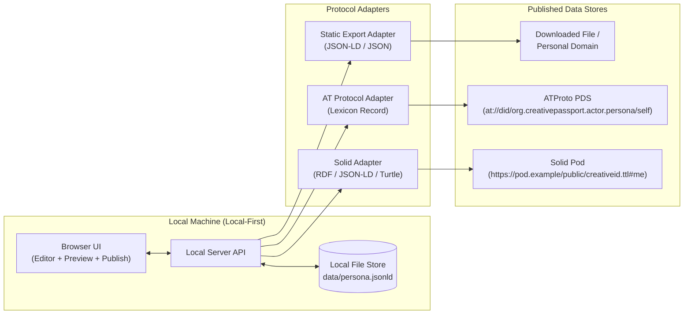

# CreativeID Studio — Version 1 Scope & Architecture

> **Note (2026-10-20):** this describes the v1 prototype. Since M4 the studio publishes the full persona as `com.cultureblocs.creative.{profile,work,connection}` records, and the static file lives at `/.well-known/creativeid.jsonld`; see [PERSONA_STUDIO_PLAN.md](PERSONA_STUDIO_PLAN.md). This document is rewritten in M7.

## 1. Vision & Core Concept
**CreativeID** is a local-first tool that empowers creators to author, own, and publish their creative persona as a portable, machine-readable dataset. 

Instead of locking identity and biographical metadata inside platform silos, creators author a **canonical local persona** on their own machine first, and then publish it to decentralized or self-hosted data stores via pluggable protocol adapters.

---

## 2. Version 1 Scope (MVP)

### In Scope for v1
1. **Persona Authoring (Browser UI)**
   - Create and edit a Creative Persona containing:
     - **Name** (`name` / display name)
     - **Biography** (`bio` / creative statement)
   - Live preview of both the human-readable card and the underlying canonical JSON-LD payload + target protocol outputs.
2. **Local-First Persistence**
   - Local backend server stores the canonical persona on disk (`data/persona.jsonld`) inside the user's project/data directory.
   - Works 100% offline for authoring, editing, and exporting.
   - Tracks publication status (last published timestamp, remote URI/CID per target).
3. **Canonical Data Model (JSON-LD)**
   - A single source-of-truth JSON-LD document using standard vocabularies (`schema.org/Person`, `foaf:Person`) so the local file is already valid Linked Data.
4. **Pluggable Publishing Adapters**
   - **Static JSON / JSON-LD Export**: Download or write a standalone `creativeid.jsonld` / `creativeid.json` file ready for hosting on a personal domain, GitHub Pages, or IPFS.
   - **AT Protocol (PDS) Adapter**: Authenticate against an ATProto Personal Data Server (via handle + App Password or OAuth) and write a custom Lexicon record (e.g., `org.creativepassport.actor.persona`) via `com.atproto.repo.putRecord`.
   - **Solid Pod Adapter**: Authenticate or connect to a Solid Pod container/resource URL and `PUT` the persona as JSON-LD or Turtle (`text/turtle` / `application/ld+json`).

### Out of Scope for v1 (Future Versions)
- Multiple personas / pseudonyms management (v1 focuses on a single primary persona per workspace, though extensible).
- Media attachments (avatars, portfolio images, audio/video samples).
- Verifiable credentials / cryptographic signatures beyond what the hosting protocol provides.
- Automated bidirectional sync / conflict resolution from remote stores back to local.
- Complex multi-step OAuth broker deployments (v1 will support direct tokens / App Passwords / local session auth for frictionless local use).

---

## 3. Architecture Overview



---

## 4. Data Schemas & Protocol Mapping

### 4.1 Canonical Local Schema (`persona.jsonld`)
Stored locally as valid JSON-LD using `schema.org` and `foaf` terms:

```json
{
  "@context": {
    "@vocab": "https://schema.org/",
    "foaf": "http://xmlns.com/foaf/0.1/",
    "cp": "https://www.cultureblocs.com/ns/creativeid#"
  },
  "@id": "#me",
  "@type": ["Person", "creativeid:Persona"],
  "name": "Ada Lovelace",
  "description": "Analytical Engine pioneer exploring poetical science.",
  "dateModified": "2026-10-17T15:20:00Z",
  "creativeid:publications": {
    "atproto": {
      "uri": "at://did:plc:example/org.creativepassport.actor.persona/self",
      "cid": "bafyre...",
      "publishedAt": "2026-10-17T15:21:00Z"
    },
    "solid": {
      "uri": "https://ada.solidcommunity.net/public/creativeid.jsonld#me",
      "publishedAt": "2026-10-17T15:22:00Z"
    }
  }
}
```

### 4.2 AT Protocol Lexicon Mapping (`org.creativepassport.actor.persona`)
Mapped by the ATProto Adapter into a deterministic singleton record (`rkey: "self"`):

```json
{
  "$type": "org.creativepassport.actor.persona",
  "name": "Ada Lovelace",
  "biography": "Analytical Engine pioneer exploring poetical science.",
  "updatedAt": "2026-10-17T15:20:00Z"
}
```
Published via XRPC `com.atproto.repo.putRecord`:
- `repo`: User's DID or handle
- `collection`: `org.creativepassport.actor.persona`
- `rkey`: `self`

### 4.3 Solid Pod Mapping
Because the canonical local schema is already valid JSON-LD (`application/ld+json`), the Solid adapter can:
1. Strip local-only publication metadata (`creativeid:publications`).
2. `PUT` the clean JSON-LD document (or serialize to Turtle `text/turtle`) directly to a target resource URL on the user's Solid Pod (e.g. `https://<pod>/public/creativeid.ttl` or `.jsonld`).

---

## 5. Recommended Tech Stack (v1)
- **Runtime**: Node.js (TypeScript) or Python (FastAPI) — lightweight zero-database local server reading/writing `data/persona.jsonld`.
- **Frontend**: Clean, minimal web UI (HTML/CSS/TypeScript or lightweight Vite/React/Vanilla UI) with:
  1. **Persona Editor** (Name, Biography, validation, character counts)
  2. **Data Inspector** (live tabs showing Canonical JSON-LD, ATProto Lexicon JSON, and Solid Turtle/JSON-LD)
  3. **Publishing Hub** (cards to configure credentials & publish to Static File, ATProto PDS, and Solid Pod)
- **Protocol Clients**:
  - ATProto: Standard `fetch` against XRPC endpoints (`com.atproto.server.createSession` + `com.atproto.repo.putRecord`) or `@atproto/api`.
  - Solid: Standard HTTP `PUT` with `Content-Type: application/ld+json` or `text/turtle` (supporting public containers, Bearer/DPoP token, or Solid OIDC session).

---

## 6. Implementation Milestones for v1
1. **Milestone 1 — Canonical Schema & Local Storage Engine**: Define TypeScript/JSON schema validation, read/write persistence to local disk, and unit tests for adapter transformations.
2. **Milestone 2 — Protocol Adapters**: Implement the Static Exporter, ATProto PDS publisher (`putRecord`), and Solid Pod publisher (`PUT` RDF/JSON-LD).
3. **Milestone 3 — Local Web UI**: Build the editor, live protocol payload previewer, and publishing controls.
4. **Milestone 4 — End-to-End Verification**: Test local authoring, file export, and mock/live publishing flows for ATProto and Solid.
