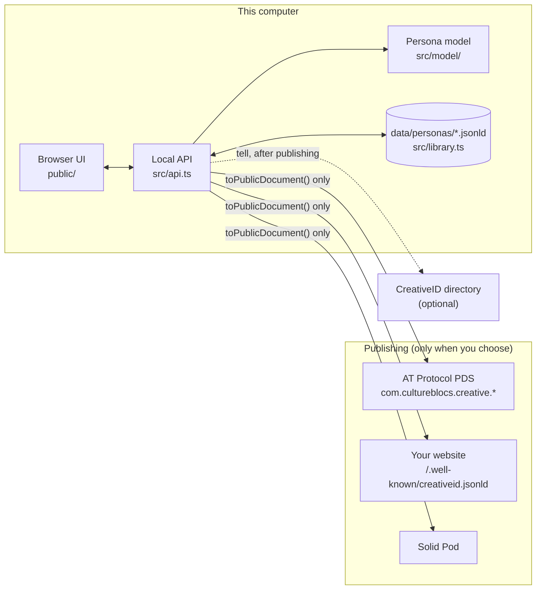

# CreativeID Studio: scope and architecture (v2)

*Updated 2026-10-20, after milestones M0–M7 of [PERSONA_STUDIO_PLAN.md](PERSONA_STUDIO_PLAN.md). The v1 scope (name and bio, `org.creativepassport.actor.persona`) is in the git history at tag `v0.1.0-creative-passport`.*

## What it is

A local-first tool for any creative or cultural practice: visual art, performance, curating, writing, sound, collectives, technical crafts. You write up the name you work under, what you've made, and who you've made it with, on your own computer. Then you publish when you choose.

It is an **optional enhancement to CultureBlocs**. Nobody needs a persona to keep a CultureBlocs diary or to make art. Making one needs no account, approval or checks. Stronger identity only comes into it when an institution needs to rely on it, which is outside this tool (see the roadmap's identity tiers).

## Principles

1. **No permission to be creative.** Only a name is required. Nothing is labelled incomplete or unverified.
2. **Local first.** The persona file on your computer is the original. Everything published is a copy of its public parts, and everything except publishing and look-ups works offline.
3. **Private stays private.** Private details live in the persona's file and never reach any output ([ADR 002](docs/adr/002-local-persona-store.md)).
4. **One persona per account.** Personas are never linked to each other in anything published.
5. **The protocol is a channel, not a home.** AT Protocol, Solid and a plain file on your own website are equal routes out.
6. **Any practice.** Disciplines, tags and roles are free text; relationships are an advisory list plus your own word.

## In scope (built)

| Area | What |
|---|---|
| Personas | Several per studio; create, rename, move to trash; v1 file imported once |
| Profile | Name, about, disciplines, based in, links, identifiers elsewhere (ISNI, ORCID, Wikidata…) |
| Works | Title, when (free text), link, description, credits (with optional DIDs), tags |
| Connections | "I performed at / exhibited / curated / am a member of … X", where X is a DID or an `at://` record. Look up turns handles into DIDs and pins records to their current version (CID) |
| Private | Key/value details kept in the file only, with suggestions from the Storage guide |
| Publish: AT Protocol | `com.cultureblocs.creative.profile` / `.work` / `.connection`; validated against vendored lexicons; incremental; deletes follow; the v1 record is removed |
| Publish: files | JSON-LD or Turtle of the whole graph, for `/.well-known/creativeid.jsonld` on your own site |
| Publish: Solid | The same graph, PUT to a Pod resource |
| Directories | Optionally tell CreativeID directories (the [aggregator](https://github.com/geocontrol/creativeid-aggregator)) after each publish |
| Preview | Live "wall label"; exact AT Protocol records, JSON-LD and Turtle |
| Storage guide | Questionnaire recommending where a persona should live |
| Sandboxes | Built-in pretend PDS and Pod, for trying the whole flow locally |

## Out of scope (later roadmap phases)

Images on works · keys for unpublished personas (`did:key`) · keychain storage for credentials · AT Protocol OAuth · a "suggestions" rail that drafts reciprocal claims when someone names you · an embeddable persona card · String / Loom integration · institutional credentials (identity tier 4) · CAWG content credentials on images · syncing personas between devices.

## Architecture

| File | Role |
|---|---|
| `src/model/` | The persona document: types, lexicon limits, TIDs, validation, add/update/remove, `toPublicDocument()` |
| `src/library.ts` | One file per persona; atomic, serialised, validated; trash; v1 import |
| `src/api.ts` | The local JSON API (`/api/personas…`, `/api/resolve`, `/api/settings`) |
| `src/atproto/records.ts` | Persona → CultureBlocs records; lexicon validation; publish plan |
| `src/adapters/` | AT Protocol, Solid and static-file publishers |
| `src/rdf.ts` | JSON-LD and Turtle of the public graph (identical triples, tested) |
| `src/resolve.ts` | Handle → DID → PDS; `at://` → CID |
| `src/settings.ts` | Directories to tell after publishing |
| `src/server.ts` | HTTP server on 127.0.0.1, sandboxes, static files |
| `lexicons/` | Read-only copies of the CultureBlocs lexicons (`npm run vendor-lexicons`) |

## Decisions

- [ADR 001: naming, namespace and schemas](docs/adr/001-creativeid-naming-and-namespace.md)
- [ADR 002: the local persona store](docs/adr/002-local-persona-store.md)
